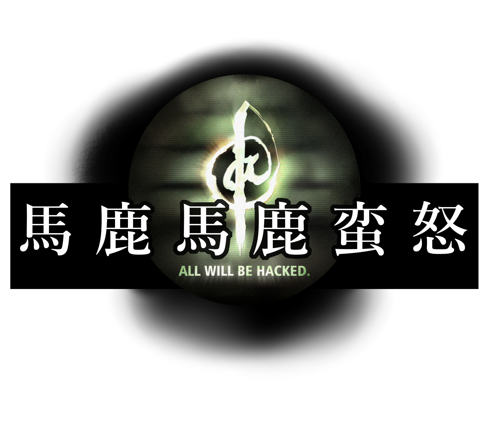

  

# 「馬鹿馬鹿蛮怒」とは

[→English summary](README_en.md)

[変愚蛮怒](https://github.com/hengband)から派生しておぞましく **絶望的にクッソ汚い** 核実験場を目指すバリアントです。

>「この門をくぐる者は一切の良識を捨てよ、あとしゃぶれよ」

→[マニュアルへ飛ぶ](/manual/readme.md)

# 当面の作業について(2022/06/24→2022/09/05→2022/10/01)

* 変愚から2022年2～3月にマージした結果、本家でも起こらなかった不具合が大量にエンバグしたので修正する。
  * これをある程度終えないとAlpha版を継続して出せない。→セーブデータに関するまずいのは直した。後は変愚上のマージを一つ一つ行う。→やべーもんだけチェリーピックで対処したのでサッサとブッチッパする。

# 「馬鹿馬鹿蛮怒」のここが **絶望的にクッソ汚い**

変愚蛮怒のバリアントとしてどこをどう **絶望的にクッソ汚い** ものとするのか指針をまとめます。

## 実装が **絶望的にクッソ汚い**

変愚蛮怒は約10年前から筆者がとにもかくにもとソースコードを弄り回すことを開始し、半端なリファクタリングを繰り返していた中、ここ2年でhradish氏の修正案やHourier氏の大規模リファクタリングを通じてようやく30年来の垢のようなクソコードをそぎ落としつつあります。2021年初頭現在、dis-氏、Habu氏などの旧製作陣、taotao氏などの新規も加え入れてようやく3.0.0Alpha版へ移行し、GitHubというありがたいサービスを利用しながらリファクタリングとデバッグを軌道に乗せています。この修正は現在も進んでおり、非常にデリケートなものです。

馬鹿馬鹿蛮怒はそれらの慎重な修正の恩恵を受けながら、文字通り馬鹿をやるために(リポジトリ管理だけは可能な限り奇麗なまま)クッソ汚い実装を繰り返します。過去に[筆者がOSDNにて頓挫したバリアント「D'angband」の旧ソース版(変愚1.X系からのフォーク)](https://osdn.net/projects/deeangband/scm/svn/)で試しつつも頓挫していた新要素などを改めて、3.0.0系の基盤に乗せ直すことにあります。

上手く行った上澄みは、本家変愚蛮怒のコミッターやユーザとの相談次第で、ひょっとすると変愚蛮怒へとフィードバックする可能性もあるかもしれませんが、根本的にクッソ汚いので期待してはいけません。

## ゲーム性が **絶望的にクッソ汚い**

馬鹿馬鹿蛮怒は前述で述べた **絶望的にクッソ汚い** 実装そのものを目的化していることに加えて、[某したらば版の某スレ](https://jbbs.shitaraba.net/bbs/read.cgi/game/9358/1564664604/l50)で思いついたようないい加減なアイデアを気まぐれで平然と咥え入れます。本家では相応に取れているゲームのバランスがどれだけガバガバになろうがお構いなしです。

1Fからさながら[しんのゆうしゃ](https://ja.uncyclopedia.info/wiki/%E3%82%B7%E3%83%A3%E3%83%89%E3%82%A6%E3%82%B2%E3%82%A4%E3%83%88)のような冗長な表現でしか形容できない有様と共に、HPから二桁違うダメージを食らって即死することもあるかもしれません。けれども安心してください。本バリアントでは本来ウィザードモードでのみ解禁される「死を欺く」モードがわずかな進行ペナルティと引き換えに無限回解禁されます。プレイヤーは幾ら死のうとも某東方ヴォイスドラマ企画で生まれたみんなのカッチャマの掛け声と共に蘇ることができるのです。やったね、たえちゃん！

例によって、まともそうな上澄みができた場合はやはり変愚蛮怒へとフィードバックされるかもしれませんが、やはり根本的にクッソ汚いので期待してはいけません。

## ネタが **絶望的にクッソ汚い**

元より\*band系ローグライクはAngbandの段階からトールキンが愛する牧歌的象徴の一つたるマゴ爺を強盗殺人するものであり、（一応[ダゴール・ダゴラス](https://arda.saloon.jp/?%E3%83%80%E3%82%B4%E3%83%BC%E3%83%AB%E3%83%BB%E3%83%80%E3%82%B4%E3%83%A9%E3%82%B9)的脳内補完はできるものでしょうが）トールキン世界の時間軸ガバガバなネタ性に溢れていました。だから、大真面目にシルマリルの物語の上古時代、ベレンとルーシエンの逸話を再現することを重点においた[sil](http://www.amirrorclear.net/flowers/game/sil/)といったバリアントが出来るくらいでありますし、年配の大真面目なトールキンファンに\*band系ローグライクの性質を少し話しただけでも、大いにツッコミを入れられたものです。

それから動機が「ナズグルの代わりにアンバーの九王子いれたったｗｗｗ」とされるZangを経て、そこからさらに日本独自のネタを大量に盛り込んだ変愚が生まれたのですから元より変愚蛮怒の時点でその世界観には、シリアスな命のやり取りと孤独行と同時に、[マジック・ザ・ギャザリングの銀枠](http://mtgwiki.com/wiki/%E9%8A%80%E6%9E%A0)要素が並列していると言わざるを得ません。はい、なので馬鹿馬鹿ではなおのこと節操なく、本宣言から繰り返している通り[「例のアレ」](https://dic.nicovideo.jp/a/%E4%BE%8B%E3%81%AE%E3%82%A2%E3%83%AC)のキーワードたる **絶望的にクッソ汚い** ネタも容赦なく通ずりっ込みます。あと、[往年からの古典的TRPGシステムでも誰がこんなモンスター塗れのサプリ使うねん](https://note.com/paladin_hilance/n/ncae95e2c795c)とか言われるようなものも色々混じることでしょう。

とはいえ、まあそんなものばっかでは流石に当の筆者も飽きると思いますので、変愚の次バージョン予備軍に出来そうなモンスターやアイテムを真面目に実装することもあるかもしれません。あるかもしれませんが、やはり根本的にクッソ汚いので期待してはいけません。

以上を踏まえた上で存分にお楽しみください。早く糞塗れになろうぜ。
