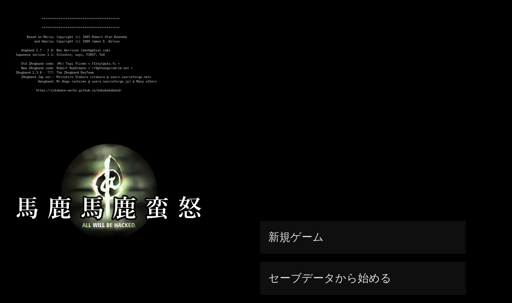
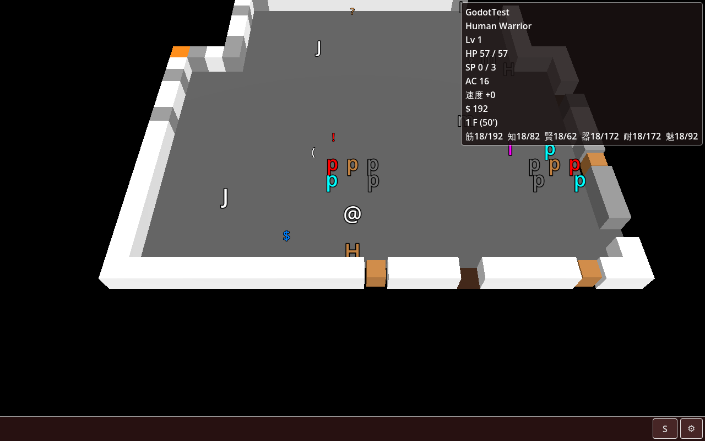
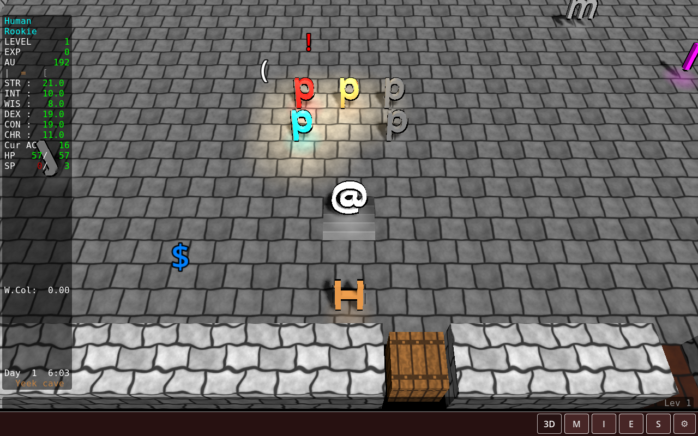
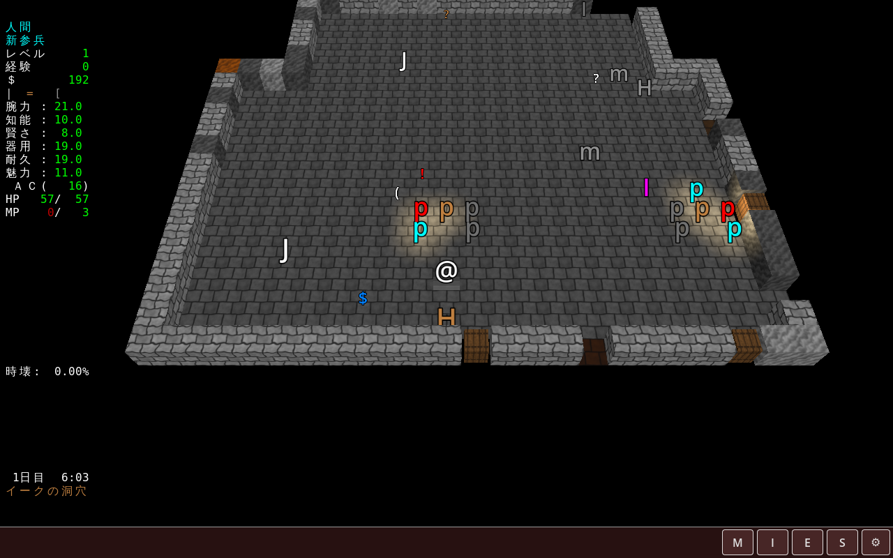
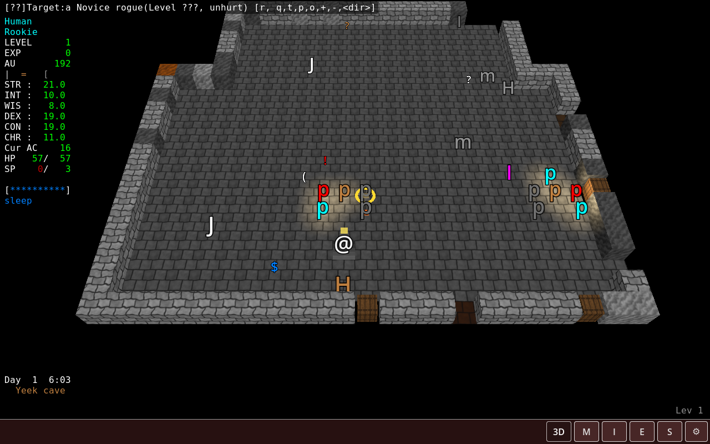
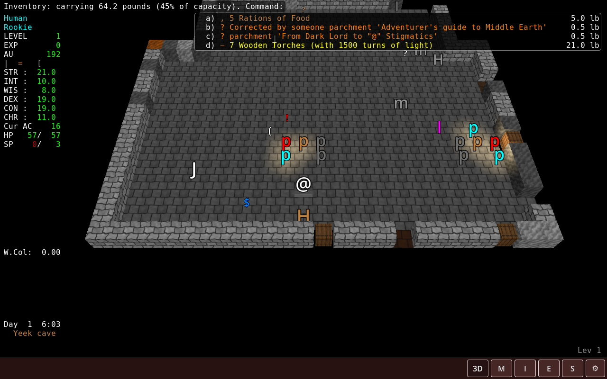
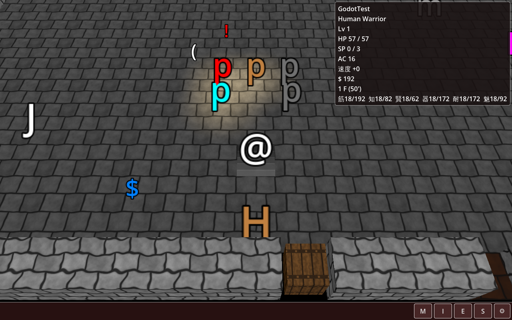
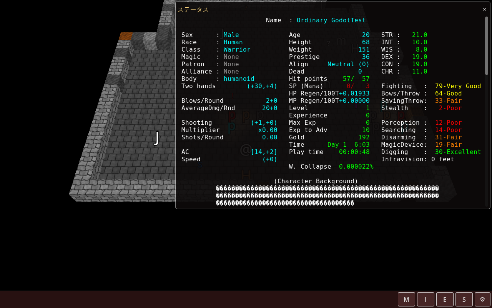
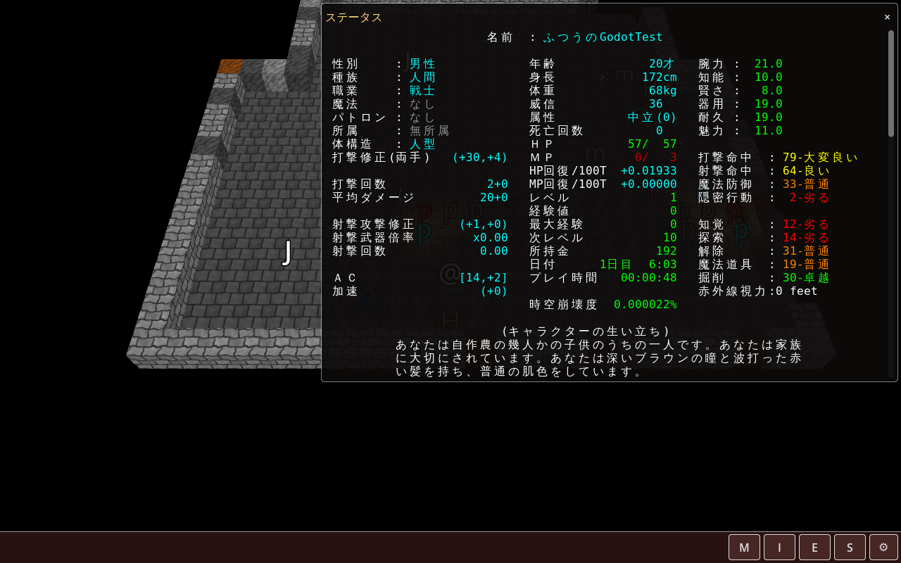
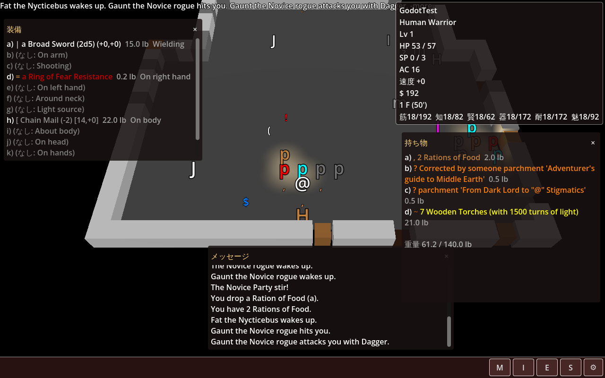

# Bakabakaband Godot インターフェース (GDExtension 移植)

[hengband-godot](https://github.com/deskull-m/hengband-godot)（変愚蛮怒 Godot 版）の
GDExtension バックエンドを bakabakaband のコードベースへ移植したものです。
Win32 GDI / WinMM に依存していた描画・音声・入力処理を
[Godot 4.x GDExtension](https://docs.godotengine.org/en/stable/tutorials/scripting/gdextension/)
に置き換え、ゲームロジック (`src/` 以下) はそのまま利用します。

## アーキテクチャ

```
┌──────────────────────────────────────────────┐
│               Godot Engine                   │
│   (レンダリング / オーディオ / 入力)         │
├──────────────────────────────────────────────┤
│                GDExtension API               │
│  ┌────────────────────────────────────────┐  │
│  │  src/main-godot/  (C++ バックエンド)   │  │
│  │  ・GodotTerminal / GodotTileLayer      │  │
│  │  ・GodotInputHandler                   │  │
│  │  ・GodotAudioManager                   │  │
│  │  ・term_type フック (godot-term-hooks) │  │
│  └────────────────────────────────────────┘  │
├──────────────────────────────────────────────┤
│   src/  (Bakabakaband ゲームコア)            │
│   ※ 専用ゲームスレッドで実行                 │
└──────────────────────────────────────────────┘
```

ゲームコアは UI ブロッキングを避けるため専用スレッド (`run_game_thread()`) で実行され、
`term_type` フック経由で Godot 側のターミナル / タイル / 入力 / 音声と連携する。

## ディレクトリ構成

```
bakabakaband/
├── src/main-godot/          # Godot バックエンド (GDExtension)
│   ├── hengband-gdextension.{cpp,h}   # GDExtension エントリ・HengbandGame ノード
│   ├── godot-init.{cpp,h}             # ゲーム初期化・スレッド起動
│   ├── godot-term-hooks.{cpp,h}       # term_type フック実装
│   ├── godot-terminal.{cpp,h}         # テキストターミナル描画
│   ├── godot-tile-layer.{cpp,h}       # タイル描画
│   ├── godot-input-handler.{cpp,h}    # キーボード・マウス入力
│   ├── godot-audio-manager.{cpp,h}    # 効果音・BGM
│   ├── godot-player-status.{cpp,h}    # プレイヤーステータスのブリッジ
│   ├── godot-player-items.{cpp,h}     # 持ち物・装備・メッセージのブリッジ
│   ├── godot-character-sheet.{cpp,h}  # ステータス画面のダンプのブリッジ
│   ├── save-file-scanner.{cpp,h}      # タイトル画面用セーブファイル一覧
│   ├── term-color-map.{cpp,h}         # 端末カラー → Godot Color 変換
│   ├── stack-trace-godot.cpp          # スタックトレース (Godot 版スタブ)
│   └── win-exception-tracer.cpp       # Windows 例外トレーサ
├── godot_project/           # Godot プロジェクト
│   ├── project.godot
│   ├── bakabakaband.gdextension
│   ├── scenes/              # title / main / terminal_pane シーン
│   ├── scripts/             # GDScript (UI ロジック)
│   └── assets/
├── godot-cpp/               # godot-cpp サブモジュール (branch 4.3)
├── bin/                     # ビルド成果物 (.so / .dll, .gitignore 対象)
└── SConstruct               # GDExtension ビルドスクリプト
```

## ビルド手順

### 必要環境

| ツール | バージョン | 用途 |
|---|---|---|
| Godot Engine | 4.3 以上 (プロジェクト設定・CI は 4.6) | 実行・エディタ |
| SCons | 4.x 以上 | ビルドシステム |
| Python | 3.8 以上 | SCons 実行環境 |
| C++ コンパイラ | C++20 対応 (MSVC v143+ / g++ / clang++) | コンパイル |

SCons が未インストールの場合は次のいずれかで導入する。

```bash
# Ubuntu / Debian
sudo apt-get install scons python3
# または pip 経由 (任意の OS)
pip install scons
```

### 1. サブモジュールの取得

`godot-cpp` (branch 4.3) をサブモジュールとして取得する。`SConstruct` は
先頭で `godot-cpp/SConstruct` を読み込むため、これが無いとビルドできない。

```bash
git submodule update --init godot-cpp
```

### 2. GDExtension ライブラリのビルド

Linux では `japanese=yes` を付けると日本語版になる (内部の文字コードは端末版の既定と同じ EUC-JP。
`-fexec-charset=euc-jp-ms` を使う)。オブジェクトファイルは英語版と別の拡張子 (`.jp.os`) に置くが、
ライブラリは同じ名前に出力するので、切り替えるたびにリンクし直しになる。

```bash
scons platform=linux target=template_debug japanese=yes
```


`SConstruct` のオプションは godot-cpp 準拠 (`platform` / `target` /
`arch` 等)。並列ビルドは標準の `-j` を付与する。

```bash
# Windows デバッグビルド (既定: platform=windows target=template_debug)
scons platform=windows target=template_debug

# Linux ビルド
scons platform=linux target=template_debug

# リリースビルド
scons platform=linux target=template_release

# 並列ビルド (推奨)
scons platform=linux target=template_debug -j$(nproc)
```

ビルド成果物は `bin/bakabakaband.<platform>.<target>.x86_64.<so|dll>` に出力され、
`godot_project/bakabakaband.gdextension` の `[libraries]` パス
(`res://../bin/bakabakaband.<platform>.<target>.x86_64.<so|dll>`) と一致する。
`bin/` は `.gitignore` 対象。

`SConstruct` はゲームコアを glob で収集し、端末版バックエンド
(`main-win` / `main-unix` / `main-x11` / `main-gcu` / `main-cap`)・`src/net/`
(libcurl 依存)・`src/test/`・autotools の Makefile.am 未収録の孤立ソースを
除外する (ただし `main-unix/unix-user-ids.cpp` だけはゲームコアが Windows 以外で
参照するため Linux 等では個別に加える)。ソースを追加・除外する際は `SConstruct` の `exclude_dirs` /
`exclude_files` / `exclude_paths` を合わせて更新すること。プラットフォーム
別のチャーセット・例外・マクロ設定 (Windows: `/source-charset:utf-8` /
CP932 実行文字コード / `WINDOWS`・`WIN32`・`JP`・`SJIS`、Linux: `-fexceptions`
再付与 / POSIX フィーチャマクロ) も同スクリプトに集約されている。

### 3. Godot からの起動

`godot_project/project.godot` を Godot エディタ (4.3 以上) で開いて実行するか、

```bash
godot --path godot_project
```

`.gdextension` の `compatibility_minimum` は 4.3。ライブラリ (`bin/`) が
未ビルドだと Godot 起動時に GDExtension のロードに失敗するため、先に
ステップ 2 を済ませておくこと。

### Windows でのビルド

Windows では **常に日本語版** (`JP` / `SJIS`) になる (`japanese=yes` は Linux 専用の指定)。
CI では Windows 向けの GDExtension をビルドしていないので、手元での確認が必要。

**必要なもの**

| ツール | 入手先・備考 |
|---|---|
| Visual Studio 2022 以降 (Community 可) | 「C++ によるデスクトップ開発」ワークロード (MSVC v143 以降 + Windows SDK) |
| Python 3.8 以上 | python.org 版。インストール時に「Add python.exe to PATH」を有効に |
| SCons | `py -m pip install scons` |
| Git for Windows | サブモジュールの取得に使う |
| Godot 4.6 (標準版) | 実行・エディタ。.NET 版は不要 |

**手順** (「x64 Native Tools Command Prompt for VS」または通常の PowerShell。SCons が MSVC を自動で探す)

```powershell
git clone https://github.com/deskull-m/bakabakaband.git
cd bakabakaband
git submodule update --init godot-cpp
scons platform=windows target=template_debug -j8
```

- 成果物は `bin\bakabakaband.windows.template_debug.x86_64.dll`。リリース版は `target=template_release`。
- 起動は Godot エディタで `godot_project\project.godot` を開いて実行するか、
  `Godot_v4.6-stable_win64.exe --path godot_project`。ゲームデータはリポジトリの `lib\` を使う
  (`main.gd` が `res://../lib` を参照するので、`godot_project` と `lib` の位置関係を崩さないこと)。
- **実行文字コード**: `SConstruct` は `/execution-charset` を指定せず、システムの既定
  (日本語 Windows では CP932) に任せている。**システムロケールが日本語でない Windows では
  文字列が CP932 にならず日本語が化ける**ので、その場合は「設定 → 時刻と言語 → 言語と地域 →
  管理用の言語の設定 → システムロケールの変更」で日本語にするか、`SConstruct` の Windows 分岐の
  `CCFLAGS` に `/execution-charset:932` を足す。
- **DLL の上書き**: Godot が起動中だと DLL がロックされてリンクに失敗する (`LNK1104`)。
  ビルド前に Godot を閉じること (`.gdextension` は `reloadable = false`)。
- MinGW でビルドする場合は `use_mingw=yes` を付ける (godot-cpp の指定)。ただし `SConstruct` の
  Windows 分岐は MSVC のフラグ (`/source-charset` / `/EHsc` / `winmm` / `DbgHelp`) を前提にしているので、
  MinGW では調整が要る (未確認)。

**端末版 (Godot を使わない Windows ネイティブ版)** は Visual Studio のソリューションでビルドする
(CI の `build-test-with-msvc.yml` と同じ)。こちらは `libcurl` サブモジュールと NuGet の復元が要る。

```powershell
git submodule update --init VisualStudio/Bakabakaband/libcurl
nuget restore .\VisualStudio\Bakabakaband.sln
MSBuild .\VisualStudio\Bakabakaband.sln /t:Rebuild /p:Configuration=Debug
```

`Bakabakaband.sln` を Visual Studio で開いてビルドしてもよい (NuGet は自動で復元される)。

## bakabakaband への移植にあたっての改変点

hengband-godot は変愚蛮怒 (上流) のコードを前提としているため、bakabakaband の
CreatureEntity 統合リファクタリングに合わせて以下を変換した
(変換規則は `CLAUDE.md`「変愚蛮怒（上流）からのマージ指針」節に準拠)。

- `p_ptr` → `PlayerType::get_instance()` / `PlayerType::get_instance_ptr()`
  (`godot-init.cpp`, `godot-term-hooks.cpp`)
- `init_angband(p_ptr, …)` / `play_game(p_ptr, …)` の引数を
  `CreatureEntity &` 形式に対応
- `player_ptr->current_floor_ptr` → `creature.get_floor()`
- プレイヤーステータス読取りを CreatureEntity の virtual アクセサ経由に変更
  (`godot-player-status.cpp`):
  - `lev` → `get_level()`、`chp`/`mhp` → `get_current_hp()`/`get_max_hp()`
  - `csp`/`msp` → `get_current_mp()`/`get_max_mp()` (提案 6 で改名済み)、`au` → `get_au()`
  - `exp`/`max_exp` → `get_exp()`/`get_max_exp()`、`pspeed` → `get_speed()`
  - `dis_ac`/`dis_to_a` → `get_dis_ac()`/`get_dis_to_a()`
  - `stat_use[]`/`stat_top[]` → `get_stat_use(i)`/`get_stat_top(i)`
  - `rp_ptr`/`cp_ptr` → `creature.get_race_info()`/`get_class_info()`
- `godot-player-status.h` に `#include <cstdint>` を追加 (GCC で `uint64_t` を使うため)
- `SConstruct` の Linux ブランチで godot-cpp 既定の `-fno-exceptions` を除去し
  `-fexceptions` を付与 (ゲームコアが例外を使用するため)
- ライブラリ名・アプリ名を `bakabakaband` にリブランド
  (GDExtension の内部クラス名・エントリシンボルは互換性のため hengband のまま)

### GODOT_RICH_UI による端末ステータス表示の抑制

**現在の Godot 版は `GODOT_RICH_UI` を定義していない** (SConstruct)。ステータスパネルが
C コマンドの画面のダンプを出すようになり、左側の欄・下段 (時刻・深さ・速度・状態バー) は
端末版と同じに描かせて、3D の地図ビューでは端末の左側の欄をそのまま重ねて見せる方針にしたため
(下記「3D の地図ビューに重ねる左側の欄」)。以下のガードはコードに残してあり、定義すれば以前の動作に戻る。

`GODOT_RICH_UI` マクロ定義時、各種ステータス値の端末描画を抑制し、Godot 側の
StatusPanel に表示を委ねる。メイン端末の行数も下段 3 行ぶん減らす。以下の関数に `#ifdef GODOT_RICH_UI` ガードを追加:

| ファイル | 関数 |
|---|---|
| `src/core/window-redrawer.cpp` | `print_dungeon` |
| `src/world/world-turn-processor.cpp` | `print_time` |
| `src/window/main-window-left-frame.cpp` | `print_depth` |
| `src/window/main-window-stat-poster.cpp` | `print_speed` / `print_study` / `print_imitation` / `print_status` |

これらのガードは通常 (autotools / MSVC) ビルドでは無効 (マクロ未定義) のため、
端末版の挙動には影響しない。

## タイトル画面 (#9317)

`godot_project/scenes/title.tscn` / `scripts/title.gd`。配置の計算は `scripts/title_layout.gd` (単体チェックから読める)。

| 置くもの | 位置 |
|---|---|
| news | 左上。日本語版は `lib/file/news_j.txt`、英語版は `news.txt` (ゲーム開始時に端末へ出すものと同じ)。どちらかは `HengbandGame.is_japanese()` で選ぶ。タイトル画像に被らないよう、画像の上端までの高さと画面幅に全行が収まる文字の大きさ (8〜20) を選ぶ |
| タイトル画像 | 左下。横幅は画面の 50% (余白を除く)。高すぎるときは画面の高さの 60% に縮める |
| 新規ゲーム・ロード | 右下。従来の倍の大きさ (600x96、文字 32) で左揃え。右半分に収まらないときは幅を縮める |



## ワールドスナップショット (観測可能ワールドモデル)

3D 表示などのために、端末のセルではなく**フロアの状態**を Godot 側へ渡す仕組み
(#9292、Epic #9290 の第 2 段)。

| 層 | ファイル | 役割 |
|---|---|---|
| ゲームコア (表示非依存) | `src/view/observable-world.{h,cpp}` | `build_observable_world(player)` がプレイヤーの知り得るフロアの状態を `ObservableWorld` に取り出す |
| ブリッジ | `src/main-godot/godot-world-snapshot.{h,cpp}` | ゲームスレッドが `TERM_XTRA_FRESH` (メイン端末) で作り、不変の `shared_ptr` で Godot メインスレッドへ渡す |
| GDScript API | `HengbandGame` | `set_world_snapshot_enabled(bool)` / `get_world_snapshot()` / シグナル `world_snapshot_changed(version)` |

- **既定は無効**。`set_world_snapshot_enabled(true)` の間だけフロア全体を走査する
  (利用者がいないときにコストを掛けない)。キャラクター作成中など
  `character_dungeon` が偽の間は作らない。
- **端末版の画面より多くの情報は含まない**:
  - 地形は `is_map_terrain_visible()` (端末の地図描画と同じ判定) が真のグリッドだけ。
    未知のグリッドは `terrain = -1` / `shape = UNKNOWN`
  - クリーチャーは `is_visible_on_map()` が真のものだけ。視界内か感知のみかは
    `OBSERVED_CREATURE_IN_VIEW` で区別する
  - 幻覚中はクリーチャーの種族・体力・状態を伏せる (ボット出力と同じ)
  - 死体は地形の分かるグリッドに限る (端末の地図は地形が未知でも描くが、
    3D では地形と切り離して置くことになるため)
- 各グリッドの表示シンボル (`symbols`、1 グリッド 4 バイト: 前景色・前景文字・
  背景色・背景文字) は `map_info()` の結果そのもの。タイル表示中はタイルの
  行・列になるので、2D タイルセットをビルボードに流用できる。
- 形状 (`shapes`) は `ObservedTerrainShape` (床・壁・扉・階段・液体・木・入口・見つけた罠等)。
  地形フラグから C++ 側で分類するので、GDScript は地形定義を持たなくてよい。
- 動作確認用に **Ctrl+Shift+M** でデバッグ用ミニマップ
  (`godot_project/scripts/world_debug_minimap.gd`) を表示できる。表示中だけ
  スナップショットが有効になる。**Ctrl+Shift+V** で検証モード (下記) を切り替える。

### 差分更新 (#9293)

| 要素 | 内容 |
|---|---|
| 観測点 | `src/view/view-observer.{h,cpp}` の `ViewObserver`。`lite_spot()` が `on_grid_changed(pos)`、`print_map()` が `on_all_grids_changed()` を呼ぶ (端末の地図・`OverviewMapCache` が描き直すのと同じ 2 か所)。未登録なら null 判定 1 回で終わり、乱数もゲームの状態も触らない |
| ブリッジ | `godot-world-snapshot.cpp` の観測者が変わったかもしれないグリッドを集め、次の push でそのグリッドだけ `observe_grid()` で求め直す。中身が実際に変わったグリッドに「最後に変わった版」を記録する |
| 全体の作り直し | 初回・`print_map()` (階の移動・画面の再描画)・フロアの大きさ/ダンジョン/階層/広域マップ表示の切替・通知の溜まりすぎ (8192 件)・スナップショットが無効だった間に変化があったとき。この版を `floor_version` とする |
| GDScript | `get_world_snapshot_changes(since_version)` が `since_version` より後に変わったグリッドだけを `indices` (行優先の添字) と同じ並びの配列で返す。`since_version` が `floor_version` より前なら全体 (`full = true`) を返す |

- **途中の版を読み飛ばしても取りこぼさない**。シグナルはフレームごとに最新の版で
  1 回しか来ないが、グリッドごとの版で比べるので、利用者は「前回受け取った版」を
  渡すだけでよい。
- **クリーチャーは差分化せず毎回全体を返す** (体力・状態の変化は `lite_spot()` を
  通らないため。走査は `m_max` までなので安い)。
- 同じ個体を追うには `creatures[].id` (`CreatureEntity::get_display_id()`) を使う。
  `m_idx` はモンスター配列の圧縮で変わり、空いた添字は別の個体に再利用される。
  `id` は圧縮では実体ごと移り、`wipe()` (添字の再利用) で付け直される。
  ゲームの進行には使わず、セーブもしない (ロード後・階の移動後は新しい番号になる)。
- **検証モード** (`set_world_snapshot_verify(true)`) では、差分で作った結果を毎回
  フロア全体から作り直した結果と突き合わせ、食い違ったグリッドを `printerr` し
  `get_world_snapshot_verify_mismatches()` に数える。`lite_spot()` を通らない
  見え方の変化を見つけるためのもので、通常は無効にしておく (全体を作り直す分だけ重い)。

## 画面の状態 (#9294)

3D 表示は地図を見ている間だけ出し、メニューや全画面の文章は端末で見せるため、
ゲームがいま何を画面に出しているかを Godot へ知らせる。

| 層 | ファイル | 役割 |
|---|---|---|
| 判定 (表示非依存) | `src/view/screen-state.{h,cpp}` | `classify_screen_state()` が入力待ちの文脈 (`io/input-context.h`)・重ねた画面の深さ (`character_icky_depth`)・重ねてから画面全体を消したか から `ScreenState` を決める |
| 画面全体を消した印 | `src/term/screen-processor.cpp` | `term_clear()` / `clear_from(0)` (メイン画面) で印を付け、`screen_save()` / `screen_load()` で外す。表示の判定にだけ使う |
| ブリッジ | `src/main-godot/godot-screen-state.{h,cpp}` | 入力待ちに入る直前 (`TERM_XTRA_EVENT`) と画面の更新 (`TERM_XTRA_FRESH`) で求め、変わったときだけ公開する |
| GDScript | `HengbandGame.get_screen_state()` / シグナル `screen_state_changed(state)` | `state` / `input_kind` / `icky_depth` / `prompt` / `has_cursor` / `cursor_x` / `cursor_y` / `overlay_x` / `overlay_y` / `overlay_w` / `overlay_h` (重ねた範囲。無ければ `overlay_w = 0`) |
| 重ねた範囲 | `src/term/screen-processor.cpp` の `calc_main_screen_overlay_region()` | 最初の `screen_save()` の時点のメイン画面 (地図) を覚えておき、いまの画面と違うセルを囲む矩形を返す (1 行目を除く)。`set_main_screen_overlay_tracking(true)` の間だけ覚える (Godot 版は起動時に有効にする) |
| 切り替え | `godot_project/scripts/view_switcher.gd` (判定の補助は `screen_overlay.gd`) | 地図ビューが登録されていて `GameState.use_map_view` が真のとき、`MAP` / `MAP_WITH_PROMPT` / `TARGETING` / `OVERLAY_MENU` の間は地図ビューを見せる (`FULLSCREEN_TEXT` は端末)。`overlay_menus_on_map` を偽にすると `OVERLAY_MENU` も端末に戻す。一覧の範囲が求まらない (一覧を開いたまま端末の大きさが変わり、比べる基準の画面と大きさが合わない) ときも、窓に何も写せないので端末に戻す |

| 状態 | 判定 |
|---|---|
| `NO_GAME` | フロアが無い (`character_dungeon` が偽。タイトル・キャラクター作成) |
| `FULLSCREEN_TEXT` | ファイル表示・一覧の閲覧・オプション・自動拾いエディタ・建物・キャラクター作成・店のコマンド待ち。または重ねた画面を開いてから画面全体を消した (キャラクター情報・知識メニューなど) |
| `TARGETING` | ターゲットの選択・見るコマンド・場所の指定。カーソルのフロア座標を `cursor_x` / `cursor_y` で渡す |
| `MAP` | 重ねた画面が無く、コマンド待ち (または入力待ちの文脈が無い) |
| `MAP_WITH_PROMPT` | 重ねた画面が無く、1 行で答える入力 (`-more-`・方向・y/n・数量・文字列・一覧を出していないアイテムや呪文の選択) |
| `OVERLAY_MENU` | 重ねた画面があり、画面全体は消していない (持ち物・アイテムや呪文の一覧など) |

**判定が曖昧なケース** (いずれも端末を見せる側に倒れるか、実害が小さいもの):

- 持ち物の一覧 (`i`) は入力待ちの文脈を設定しないので `input_kind = -1`。重ねた画面の深さだけで `OVERLAY_MENU` になる。
- 重ねた画面の上で `term_clear()` / `clear_from(0)` を使わずに全行を書き換える表示は `OVERLAY_MENU` になる (全画面の表示だが、地図ビューを隠す側なので安全)。
- 見るコマンドの途中でモンスターの思い出などを重ねて表示し、その間に新しい入力待ちの文脈を設定しない場合は `TARGETING` のまま (地図ビューを見せたまま端末に説明が出る)。
- 入力待ちの文脈は「対応した入力待ちだけ」が設定するので、文脈の無い入力待ちは重ねた画面の深さだけで決まる。

`tools/godot/screen-state-runtime-check.gd` で実ゲームの遷移を確かめられる (地図 → 持ち物 → キャラクター情報 → 見る → 知識 → 投げる → 方向入力 → 再びキャラクター情報 → 持ち物 の 17 遷移が期待どおり)。

## 表示用のゲームイベント (#9295)

3D 表示のアニメーション・エフェクトのため、プレイヤーが知覚できた出来事を型付きで流す。

| 層 | ファイル | 役割 |
|---|---|---|
| イベントと受け手 | `src/view/view-event.{h,cpp}` | `ViewEvent` / `ViewEventSink`。未登録なら呼出側は `is_view_event_sink_active()` の 1 判定で何もしない。乱数・ゲーム状態には触れない |
| 発火点 | 下表 | 1 行の `notify_view_*()` |
| ブリッジ | `src/main-godot/godot-game-events.{h,cpp}` | 有効な間キューに溜め (最大 1024、溢れたら古いものを捨てる)、毎フレーム `game_events(Array)` シグナルで古い順に渡す |
| GDScript | `HengbandGame.set_game_events_enabled(bool)` / シグナル `game_events(events)` | 既定は無効 |

| 種類 | 発火点 | 知らせる条件 |
|---|---|---|
| `MELEE` (1) | プレイヤー: `exe_player_attack_to_monster()` の各打撃 / モンスター→プレイヤー: `MonsterAttackPlayer::process_monster_blows()` / モンスター同士: `monster-attack-monster.cpp` | どちらかが見えている。見えない側は `id = 0`・座標なし |
| `PROJECTION` (2) | `project()` (効果範囲が決まった直後) | 盲目でなく `PROJECT_HIDE` でない (端末版の描画と同じ)。軌跡・効果範囲はプレイヤーの視線が通るグリッドだけ。どちらも空なら知らせない |
| `DAMAGE` (3) | `CreatureEntity::apply_raw_damage()` (プレイヤー・モンスター共通のプリミティブ) | プレイヤー、または見えているモンスター |
| `DEATH` (4) | `monster_death()` の冒頭 / プレイヤーの `take_hit()` の死亡判定 | 同上 |
| `MOVE` (5) / `TELEPORT` (6) / `APPEAR` (7) / `DISAPPEAR` (8) | ブリッジがワールドスナップショットの前回との差から作る (コアからは流さない) | スナップショットも有効なとき、同じ階の中だけ |

- **移動をコアから流さない理由**: `set_position()` の呼出は 25 か所あり、生成・ロードも通るため。
  スナップショットのクリーチャーの表示用 ID と座標を比べれば、歩行も瞬間移動も出入りも分かる。
- **`TELEPORT` は「スナップショットの間に 2 グリッド以上動いた」の意味**。加速したモンスターが
  1 回の画面更新の間に 2 歩進んだ場合も `TELEPORT` になる (実測で確認)。演出側は距離で補間の仕方を決めること。
- **演出のためにゲームを待たせない** (非ブロッキング)。受け手は後追いで再生する。
  ボルトの軌跡を見せ切ってから次へ進めたい場合の待ち合わせは将来の拡張。
- `tools/godot/game-events-runtime-check.gd` で実ゲームのイベントを数えられる
  (地下 1 階で移動 24・瞬間移動 1・近接 22・被弾 12・死亡 1 を確認。呪文を撃たせていないので `PROJECTION` は未確認)。
- デバッグ用ミニマップ (Ctrl+Shift+M) の右側に直近のイベントを一覧する。

## 座標・方向で指定する入力 (#9296)

3D 表示ではクリック・タッチやカメラ相対の方向で操作したい。キーで送ると「カーソルを何マス
動かすか」に分解しなければならない入力を、座標のまま渡す。

| 層 | ファイル | 役割 |
|---|---|---|
| 意図 | `src/io/input-intent.{h,cpp}` | `push_point_intent(purpose, pos)` で積み、ゲームが場所を尋ねるところで用途が一致するものだけを取り出す。2 秒で失効。積まなければ何も変わらない (キー入力・ボット・リプレイに影響なし) |
| 取り出す所 | `point_target()` (`POINT`) / `target_set()` (`TARGET`、見るコマンドは除く) | 意図があれば尋ねずにその座標を使う。ターゲットは見えていて狙えるモンスターがいればそのモンスター、いなければその場所 |
| GDScript API | `HengbandGame.travel_to(x, y)` / `target_grid(x, y)` / `walk(dir)` | 地図を見ていてコマンドを受け付けるとき (`MAP` かつコマンド待ち) だけ、意図を積んで元祖のコマンド (`` ` `` / `*` / `;`+方向) を送る。キー配置 (keymap) を通さないよう `\` を前置する。送ったら true |
| 補助 | `godot_project/scripts/input_intents.gd` | カメラ相対の方向 → ゲームの方向 (`rotate_direction`)、ベクトル → 8 方向、端末のセル → フロア座標 (`cell_to_floor`)、3D 座標 ↔ フロア座標 (X 軸 = 東、Z 軸 = 南、1 グリッド = 1) |
| 2D 端末 | `terminal_pane.gd` | メイン端末の地図を左クリックでトラベル、右クリックでターゲット |

- 端末のセルからフロア座標へは `get_screen_state()` の `map_col0` / `panel_col_min` /
  `panel_row_prt` / `bigtile` で直す (`x = (列 - map_col0) / (bigtile ? 2 : 1) + panel_col_min`、`y = 行 + panel_row_prt`)。
- 見るコマンドを座標で始める意図は未実装 (見るコマンドの対話をそのまま使う)。
- `tools/godot/input-intents-runtime-check.gd` で実ゲームを確かめられる
  (1 歩歩く・`@` のセルの変換・5 グリッド先へのトラベル・ターゲット後に地図へ戻る、すべて期待どおり)。
- 補助関数の確認は `tools/godot/gdscript-unit-check.gd` (CI でも実行)。

## 見た目の定義 (#9297)

3D で何を描くかをコードに埋め込まず、`godot_project/data/visuals.jsonc` で決める。
約 2,600 種のモンスター全てにモデルを用意するのは現実的でないので、**定義が無ければ
端末と同じ文字・色のビルボードにフォールバック**する (定義が空でも全てを描ける)。

| 要素 | 場所 | 内容 |
|---|---|---|
| 定義ファイル | `godot_project/data/visuals.jsonc` | `terrain.by_tag` (地形の `key`) / `terrain.by_shape` (形状の名前) / `monsters.by_race` (種族 ID) / `monsters.by_symbol` (文字) / `items.by_tval` (種別)。1 件は `mesh` / `sprite` / `shape` (`box`・`plane`・`none`) / `scale` / `height` / `color` / `texture` / `overlay_glyph` (箱・板の上に端末の文字も立てる。見つけた罠 `TRAP` で使う) |
| 解決 | `godot_project/scripts/visual_catalog.gd` | 地形: by_tag → by_shape → 文字。クリーチャー: by_race → by_symbol → 文字。床アイテム: by_tval → 文字。幻覚中のクリーチャーは `?`。JSONC (コメント・末尾のカンマ) を読む |
| 地形の一覧 | `HengbandGame.get_terrain_catalog()` (`build_terrain_catalog()`) | 地形 ID → タグ・名前・形状・定義上の文字と色。定義ファイルを地形のタグで書けるようにするため |
| クリーチャー・床アイテム | スナップショットの `creatures[].symbol` / `symbol_color`、`object_tvals` | 見かけの種族の定義上の文字 (タイル表示の設定に依らない)。幻覚中は伏せる |
| 色 | `HengbandGame.get_term_color(index)` | 端末の色の番号 → Color |
| タイル | `VisualCatalog.tile_region(row, col, cell_size)` | タイル表示中は `symbols` の色・文字がタイルの行・列になるので、既存の 2D タイルセットをビルボードのテクスチャに流用できる |

- 実測 (地下 1 階): 地形の一覧 345 件、既知のグリッド 449 件・見えているクリーチャー 19 体・
  床アイテム 5 個の見た目がすべて決まる (`tools/godot/visual-catalog-runtime-check.gd`)。
- 定義の解決の確認は `tools/godot/gdscript-unit-check.gd` に含む (CI でも実行)。

## 3D の地図ビュー (最小構成、#9298)



`godot_project/scripts/dungeon_view_3d.gd` (`SubViewportContainer`) が、ワールドスナップショットを
3D で描く。下のバーの **「3D」ボタン** か **Ctrl+Shift+D** (または `GameState.use_map_view`) で有効にすると、`view_switcher.gd` が
地図を見ている間だけ見せ、メニュー・全画面の文章では端末に戻す。

| 要素 | 実装 |
|---|---|
| 地形 | 箱用・板用の `MultiMesh` を 1 つずつ。**グリッドごとにインスタンスを 1 つ割り当て**、差分では変わったグリッドのインスタンスだけ書き換える。全体はバッファ (`MultiMesh.buffer`) をまとめて渡す。見た目は `visual_catalog.gd` で地形 ID ごとに 1 度だけ解決してキャッシュ |
| クリーチャー・プレイヤー | 表示用 ID ごとに、文字を押し出した立体 (`TextMesh`、端末の色、少し自己発光、黒の縁取り) と足元の円を 1 組で置く (`_make_token`)。立体の文字はカメラの水平の向きに合わせて回し、上から読みやすいよう 15° 後ろへ傾ける。足元の円は中心から外へ透明になる放射状のグラデーション (`GradientTexture2D`) で、どのグリッドにいるかを示す。縁取りは材質の `next_pass` に、法線方向へ膨らませた裏面だけを黒で描く材質を重ねる (背面法)。1 グリッド程度の移動は Tween で滑らかに動かす。感知のみのものは暗く |
| 影 | 平行光とプレイヤーの光源が影を落とす。**影を落とすのはクリーチャー・プレイヤーの立体の文字だけ**で、地形は影を受けるだけにしている (壁の影で明るさの段階が読みにくくなるのと、影の描画を軽くするため)。モンスターの光源は影を落とさない |
| 床アイテム | 文字を押し出した立体 (`TextMesh`、黒の縁取り付き) を**床に寝かせて**置く (`_make_item_token`)。文字の上端がカメラの奥を向くよう、カメラの水平の向きに合わせて回す。地形を知らないグリッド (感知など) でも描く。タイル表示中は `symbols` がタイルの位置なので、定義の無い床アイテムは `&` で描く |
| 文字で描く地形 | 定義の無い地形 (`kind = glyph`) と `overlay_glyph` を指定した地形 (見つけた罠) は、端末の文字の `Label3D` を立てる |
| カメラ | プレイヤーを斜め上から追う。中ボタンのドラッグで回転、Shift + ホイールで寄る・引く |
| クリック | 床の高さの平面に投影してフロアの座標を求め、左でトラベル・右でターゲット |
| メッセージ | 端末の 1 行目を重ねて見せる |
| 視界・光源・記憶 | 下記 (#9299) |



- **性能 (headless で計測)**: 全体の作り直しは地下 1 階 (60×60) で 9 ms、街 (242×242) で 212 ms
  (階に入ったときだけ)。差分の反映は 0.1〜0.3 ms (22〜36 グリッド)。
- `tools/godot/dungeon-view-runtime-check.gd`: 置いた箱・板・ビルボードの数がスナップショットと
  一致すること、持ち物を開くと隠れて戻ると見えること、移動に追従することを確かめる
  (headless では `MultiMesh.get_instance_transform()` が値を返さないので、ビュー自身が覚えている
  グリッドごとの種類で数える)。設定は利用者の設定ファイルではなく `user://runtime-check-config.cfg`
  に書く (`GameState.config_path`。環境変数 `HB_CONFIG_PATH` でも変えられる)。
- `tools/godot/screenshot.gd`: 仮想ディスプレイ + ソフトウェア OpenGL で実際に描いた画面を保存する。
- 未対応: `visuals.jsonc` の `mesh` / `sprite` は現状は床の板で代用 (定義の無い地形は文字のビルボード)、近接攻撃・ボルトの演出 (#8805 等)。

### 3D の地図ビューに重ねるメッセージ・左側の欄・下端の状態バー

3D の地図ビューを見ている間、端末の次の 3 か所を半透明の窓で常に重ねる
(`scripts/status_sidebar.gd`、`Region` で写す範囲を選ぶ)。

| 範囲 | 写す矩形 | 置き場所 |
|---|---|---|
| `LEFT_PANEL` 左側の欄 (種族・職業・レベル・経験・所持金・装備の記号・能力値・AC・HP・MP・時空崩壊度・日付・ダンジョン名など) | 左の 12 桁 (`COL_MAP`) × メッセージの行の下から最下行の上まで | 左上 (メッセージの行の下) |
| `MESSAGE_LINE` メッセージ (`-more-`・プロンプトを含む) | 1 行目の全幅 | 上端 |
| `BOTTOM_BAR` 状態バー (時限効果・空腹・学習・速度・深さなど) | 最下行 (`ROW_STATBAR` / `ROW_SPEED` = -1) の全幅 | 画面の下、下のバーの上 |



- 端末 (`GodotTerminal`) は地図ビューを見ている間も裏で描かれ続けているので、その矩形を
  `GodotTerminal.get_region()` で取り出して写す。**並び・色・文言は端末版とまったく同じ**で、
  ゲーム側の描画の規則を二重に持たない。
- 写し直すのは端末の内容が変わったときだけ (`GodotTerminal.get_content_version()`)。
- 文字は端末と同じ桁の格子 (`character_sheet_view.gd`) で描くので全角も崩れない。色は下位 4 ビット
  (日本語版の端末が全角の桁に重ねる印を除く)。
- メッセージと下端の帯は使っている一番右の桁までの幅にし、中身が空なら隠す。
- 写す端末はメインの端末 (`terminal_index == 0` のペイン)。以前の 3D ビュー内の 1 行目の表示は
  最初に見つかった `GodotTerminal` を読んでいたため、サブウィンドウのペインを持つレイアウトでは
  別の端末の行を出しうる上、色の無いプロポーショナルな文字だった。端末の写しに置き換えて解消した。
- 窓はマウスの操作を通す (地図のクリックを妨げない)。

### ターゲットの選択・場所の指定のカーソルと射線



端末ではカーソルが地図のマスを指すが、3D ビューには端末のカーソルが無い。そこで画面の状態が
`TARGETING` (ターゲットの選択 `*`・見るコマンド `l`・次元の扉などの場所の指定) の間、
3D ビューにカーソルと射線を描く (`dungeon_view_3d.gd` の `apply_target_state()`)。

| 描くもの | 内容 |
|---|---|
| 照準の輪 | カーソルのマス (`get_screen_state()` の `cursor_x` / `cursor_y`) に、ゆっくり回って脈打つ輪を置く。ターゲットの選択と見るコマンドは黄、場所の指定は緑。壁に埋もれないよう奥行きを無視して描く。立体の文字の材質は奥行きの先描き付きの半透明 (`TRANSPARENCY_ALPHA_DEPTH_PRE_PASS`、優先度 0) にして印 (優先度 -1) より後に描くので、印がクリーチャーの文字を隠さない (不透明だと半透明の印より先に描かれ、上から塗られる) |
| 射線 | **ターゲットの選択 (見るコマンドを除く) のときだけ**、プレイヤーからカーソルまでのマスに印を並べる。見えているクリーチャーのマス (ボルトはそこで当たる) は橙、その先は薄く、記憶している壁などで止まる最後のマスは赤 |
| カメラ | カーソルを出している間はプレイヤーとカーソルの中間を見て、両方 (と周り 1.5 グリッド) が画面に収まるまで引く (`targeting_camera_distance()`)。利用者の寄り具合 (`_camera_distance`) は変えないので、選び終えると元に戻る |

- 射線はゲーム側の `observe_target_path()` (`src/view/observable-world.cpp`) が求める。
  経路はゲームの投射と同じ直線 (`ProjectionPath`) で、射程はゲームの `MAX_RANGE`。
  **止まる位置はプレイヤーが知っていることだけで決める**: 記憶している地形が投射を通さない
  マスで止め、知らない壁では止めない (壁の位置を明かさない)。クリーチャーも見えているものだけを数える。
- 受け渡しは `get_screen_state()` の `target_path` (x, y, x, y, ...) / `target_path_blocked` /
  `target_path_creature_index`。カーソルが動くたびに入力の文脈が変わるので、画面の状態と一緒に公開される。
- 確認: `tools/godot/dungeon-view-runtime-check.gd` (`*` で照準の輪と射線、`l` で輪だけ、閉じると消える)、
  単体テスト (`src/test/view/test-observable-world.cpp`: 記憶している壁で止まり、知らない壁では止まらない)。

### 地図の上に重ねた一覧 (持ち物・装備など) を半透明の窓で見せる



持ち物 (`i`)・装備 (`e`) の一覧やアイテム・呪文の選択の一覧のように、`screen_save()` で
**地図の上に重ねた画面 (`OVERLAY_MENU`)** の間も 3D の地図ビューのまま、その一覧だけを
半透明の窓 (`Region.OVERLAY`) に写す。端末の画面には戻らない。

- 写す範囲はゲーム側が求める (`calc_main_screen_overlay_region()`)。**最初の `screen_save()` の
  時点のメイン画面と比べて違うセルを囲む矩形**で、1 行目 (プロンプトはメッセージの行の窓が写す) は除く。
  一覧の位置・大きさを GDScript 側で推測しないので、どのコマンドの一覧でも同じ仕組みで写せる。
  一覧の中から別の一覧を重ねた場合 (持ち物 → アイテムのコマンド) は両方を囲む。
- 窓は**端末で一覧が出ている位置**に置き、画面からはみ出さないよう寄せる (`overlay_position()`)。
  背景は他の窓より濃くし (不透明度 0.78)、枠線を付ける。
- `FULLSCREEN_TEXT` (店・知識・キャラクター情報・ヘルプなど、重ねてから画面全体を消した表示) は
  従来どおり端末に戻す。
- 比べる基準の画面はメイン端末の `term_win` の写し 1 枚 (80×24 なら数 KB) で、`screen_save()` で
  深さが 0 → 1 になるときだけ取り、深さ 0 に戻ったら捨てる。ゲームの進行・乱数には触れない。
- 地図と同じ文字・色で一覧の空白を書いたセルは「違うセル」にならない。一覧の縁が地図の空白と
  重なる場合は矩形が 1 桁狭くなりうるが、写す中身は端末と同じなので読めなくなることはない。
- 確認: `tools/godot/dungeon-view-runtime-check.gd` (持ち物を開いても 3D のまま、窓の中身が端末の
  矩形と一致、キャラクター情報では端末に戻る)。

### 地形のテクスチャ

壁・扉・床などの箱と板には、`data/visuals.jsonc` の `texture` で指定したテクスチャを貼る
(形状ごとの既定 `by_shape` と、地形のタグごとの上書き `by_tag`。永久壁・岩脈・煉瓦・木の壁・
瓦礫・草・土などを分けている)。



- **テクスチャ**: `godot_project/assets/textures/terrain/<名前>.png` (128x128、継ぎ目なし、
  グレースケール)。`tools/godot/gen-terrain-textures.py` (numpy / Pillow、乱数の種は固定) で
  生成したもので、外部の素材は使っていない。差し替えるときは同じ大きさの PNG を置けばよい。
- **色**: テクスチャに端末の地形の色と明るさの段階 (#9299) を掛けるので、溶岩の赤・水の青・
  記憶だけのグリッドの暗さなどは従来どおり。テクスチャ自体は明暗の模様だけを持つ。
- **描き方**: `shaders/terrain.gdshader`。テクスチャは `Texture2DArray` にまとめ、
  インスタンスごとの層を MultiMesh のカスタムデータで選ぶ (描画呼び出しは箱・板の 2 つのまま)。
  UV はワールド座標から作るので 1 グリッド = テクスチャ 1 枚で、箱の大きさに依らず模様の縮尺が揃い、
  隣り合う壁の模様もつながる。
- テクスチャは `Image.load_png_from_buffer()` で直接読む (インポートを通さない)。
  書き出し (export) するときは `assets/textures/*` をリソース以外のファイルとして含めること。
  読めないテクスチャは警告を出して無地で描く。

### 視界・光源・記憶の表現 (#9299)

**見え方の判定はすべてゲーム側の値 (スナップショット) に従う**。3D の光の届き方で見えるかどうかを
決めることはしないので、端末版より多くの情報は出ない。

| 状態 | 判定 (スナップショット) | 表現 |
|---|---|---|
| 未知 | `terrain = -1` | 描かない |
| 視界内で明るい | `IN_VIEW` かつ `LIT` (光源・部屋の照明・`CAVE_MNLT`) | 定義の色そのまま |
| 視界内だが暗い | `IN_VIEW` で `LIT` でない | 明るさ 0.55 倍 |
| 記憶だけ | `IN_VIEW` でない (盲目なら全グリッド) | 明るさ 0.3 倍・彩度 0.25 倍 |

- **プレイヤーの光源**: スナップショットの `player_light_radius` (`get_cur_lite()`) に合わせて
  `OmniLight3D` の届く範囲を変える (松明 → ランタンで広がる)。盲目なら消す。
- **光を持つモンスター**: `creatures[].light_radius` (`HAS_LITE_1` / `HAS_LITE_2`) の個体に光を置く
  (最大 16)。幻覚中は種族が分からないので置かない。
- **盲目**: スナップショットの `player_blind` が真なら、視界のフラグに依らず全グリッドを記憶として描く。
  切り替わったときは全グリッドの色を塗り直す。見えているモンスターは元々ゲーム側で消える。
- **記憶の中のモンスター**: `is_visible_on_map()` に従う (端末版と同じ。感知だけのものは暗く描く)。
- 実測 (地下 1 階): 光を持つモンスター 7 体に光、明るさの 3 段階と盲目の扱いを
  `tools/godot/dungeon-view-runtime-check.gd` で確認。

### 実ゲームでの確認

`tools/godot/world-snapshot-runtime-check.gd` が `main.tscn` を headless で起動して
セーブを読み込み、移動しながら差分を手元に反映して全体と突き合わせる。

```bash
HB_SAVE=<使い捨てのセーブファイル> godot --headless --path godot_project \
    --script "$PWD"/tools/godot/world-snapshot-runtime-check.gd
```

チェックスクリプトはゲームのスレッドを止めずに抜けるため、最後に自分のプロセスを強制終了する
(成否に関わらずシェルからは異常終了に見える)。成否を終了コードで受けたいときは
`tools/godot/run-runtime-check.sh` を通す (出力の `RESULT: OK` を見て 0 / 1 を返す。
`GODOT` で実行ファイル、第 2 引数で制限秒数を指定できる)。

```bash
HB_SAVE=<使い捨てのセーブファイル> sh tools/godot/run-runtime-check.sh tools/godot/world-snapshot-runtime-check.gd
```

セーブは端末版のヘッドレス実行 (`tools/bot/README.md`) で作れる。端末版と Godot 版の
Linux ビルドで日本語/英語が違っても読み込める。実測 (地下 1 階、可視モンスター 19 体、
154 版): 差分 109 グリッドを反映した手元の配列が全体と一致、検証モードの食い違い 0、
クリーチャーの `id` は 19 体とも全期間で不変。

`GodotTerminal.get_row_text(y)` で端末の行を読めるので、スクリプトから画面を確認できる。

## ステータスパネル (C コマンドの画面のダンプ)

下のバーの **S** ボタンで開くステータスパネルは、C コマンドのステータス画面を
**キャラクタダンプの先頭 (`[キャラクタ情報]` の直後) と同じ内容そのまま** 表示する
(5 画面ぶん、約 90 行。スクロールで見る)。題名の部分をドラッグすると動かせ、位置は保存される。



- **ゲームコア側**: `io-dump/player-status-dump` の `collect_player_status_dump()` が
  ダンプの各行を「文字列 + 各バイトの端末の色」で作る。ファイルへのダンプ (`dump_aux_player_status()`) も
  これを書き出すだけにしたので、パネルとダンプのファイルは同じ処理から出る
  (変更前後でダンプのファイルが同一であることを端末版で確認済み。違ったのはプレイ時間の秒だけ)。
- `collect_player_status_dump_offscreen()` は、画面に出していない 80x48 の端末 (`term_init()` の
  既定のフックだけを持つ) に切り替えて描き、元の端末に戻す。いまの画面 (地図) には触れない。
- **ブリッジ**: `src/main-godot/godot-character-sheet.{h,cpp}`。1 回作るのにステータス画面を 5 枚描くので、
  `TERM_XTRA_FRESH` のうちゲームターンが進んだときだけ作り直し、中身が変わったときだけ公開する。
  パネルを表示している間だけ有効 (`set_character_sheet_enabled()`)。
- **API**: `get_character_sheet()` (`text` = ダンプの各行、`lines` = 空白以外の文字ごとの
  桁・占める桁数・文字・色) と `character_sheet_changed` シグナル。
- **等幅の描画**: `scripts/character_sheet_view.gd` が文字ごとに「桁 × 半角の字幅」の位置へ描く。
  フォントの字幅が端末と違っても桁が揃う。全角 (2 バイト文字) は 2 桁を占め、2 桁より広い字は横に縮める。
  フォントは端末と同じ (`GameState.font_name` / `font_size`、設定の変更にも追従)。
- 実ゲームでの確認: `tools/godot/character-sheet-runtime-check.gd` (ダンプの取得、パネルへの描画、
  作っても地図の画面のままであること、ターンが進むと作り直されること、C コマンドで端末に出した
  画面の各行とダンプの先頭の画面が一致すること)。
- 日本語版で作ったセーブを英語版で読むと、生い立ち (Character Background) などセーブに保存された
  文字列は文字コードが合わず化ける (端末版でも同じ)。
- **日本語版**: 全角の字も桁が揃うことを確認済み (下図、Linux の既定の等幅フォント + 日本語フォントの代替)。
  日本語版の端末は全角の左右の桁に印 (`AF_KANJI1` = 0x10 / `AF_KANJI2` = 0x20) を色に重ねるので、
  ブリッジで色の部分 (下位 4 ビット) だけを渡している。
- 表示を開いたとき、ゲームが入力待ちで画面の更新が無くても、入力待ちの間 (100 ミリ秒ごとに起きる) に作る。



## メッセージ・持ち物・装備のウィンドウ

下のバーの **M / I / E** ボタンで、メッセージ・持ち物・装備のウィンドウを開け閉めする
(`godot_project/scripts/item_window.gd`)。題名の部分をドラッグすると動かせ、
開いているかと位置は `GameState.item_windows` に保存される。



- **ゲームコア側**: `src/view/observable-inventory.{h,cpp}` が持ち物・装備
  (`observe_inventory()`) と直近のメッセージ (`observe_recent_messages()`、古い順) を
  取り出す。品名は `describe_flavor()`、色は `tval_to_attr()` (充填中は暗い灰色)、
  記号はベースアイテムの表示定義、装備欄は `can_equip_to()` で体構造上使えない部位を区別する。
  プレイヤーが知り得る範囲 (端末版の `i` / `e` / `^P` と同じ) しか含まない。
- **ブリッジ**: `src/main-godot/godot-player-items.{h,cpp}`。ゲームスレッドが
  `TERM_XTRA_FRESH` で取り出し、前回と違うときだけ版を進めて公開する
  (メッセージは件数と最新の 1 件で変化を判定。同じ文の繰り返しは最新の 1 件の `<xN>` に現れる)。
  文字列は UTF-8 に直して渡す。`HengbandGame.set_item_windows_enabled(true)` の間だけ動く
  (`main.gd` が起動時に有効にする)。
- **API**: `get_inventory()` (`pack` / `equipment` / `total_weight` / `weight_limit`、
  重さは 1/10 ポンド単位、色は端末の色の番号) と `get_messages()` (最大 200 件)。
  変わったときに `inventory_changed` / `messages_changed` シグナルが出る。
- ウィンドウは隠れている間はシグナルを受けても描き直さない。
- 実ゲームでの確認: `tools/godot/item-windows-runtime-check.gd` (持ち物 4 品・装備 13 部位の取得、
  ウィンドウへの描画、`,` と `d` でのメッセージ・持ち物の更新)。整形関数は
  `gdscript-unit-check.gd` で確かめる。
- **未実装**: ウィンドウからの操作 (クリックで使う・装備を外す等) と大きさの変更。
  日本語版の端末で作ったセーブを英語版の Godot で読むと、セーブ内のメッセージ履歴は
  文字コードが合わず化ける (新しく出たメッセージは正しく出る)。

## 既知の制限・今後の課題

- **端末の大きさの変更はゲームスレッドで反映する**。Godot 側 (`set_sub_window_size()`) は
  `request_term_resize()` で頼むだけにし、ゲームスレッドが入力待ち (`TERM_XTRA_EVENT`) の合間に
  `apply_pending_term_resizes()` で `term_resize()` する。Godot スレッドで直接 `term_resize()` すると、
  ゲームスレッドが画面を読んでいる最中 (`screen_state_update()` の一覧の範囲の比較など) に配列の大きさが
  変わりうるため。ゲーム開始前は従来どおりその場で反映する。

- **セーブファイル形式**: `save-file-scanner.cpp` はタイトル画面のセーブ一覧表示用に
  セーブファイルヘッダを独自に走査する。bakabakaband のセーブデータ
  バージョン (現在 63、`SAVEFILE_VERSION`) は上流と形式が異なるため、表示内容の検証・調整が必要。
- **ネットワーク機能**: `src/net/` (libcurl 依存) は GDExtension ビルドから除外している。
- **状態バー (`print_status`)**: 現状は端末描画を抑制するのみで、Godot StatusPanel への
  移行は未実装。
- **Windows (MSVC) 向けの GDExtension ビルドは CI 対象外**。CI は Linux 向けのみ
  (下記「CI」節)。

## CI

`.github/workflows/build-godot-gdextension.yml` が、`src/**` / `SConstruct` /
`godot-cpp` / `godot_project/**` を変更する PR で次を行う。

1. `scons platform=linux target=template_debug` で GDExtension ライブラリをビルド
   (`SCONS_CACHE` によるオブジェクトキャッシュ付き)
2. Godot (`GODOT_VERSION`、`project.godot` の `config/features` に合わせて 4.6) を
   headless で起動し、`.github/scripts/check-godot-extension-load.gd` で
   拡張のクラス (`HengbandGame` / `GodotTerminal` / `GodotTileLayer` /
   `GodotInputHandler` / `GodotAudioManager`) が登録されたことを確認する

加えて、同じ手順を日本語版 (`japanese=yes`) でも行う (`build-japanese` ジョブ)。

2 はゲームスレッドもタイトル画面も起動しないので、ゲーム内容の動作確認ではない。
未定義シンボル・初期化時の例外などで**ライブラリが読み込めなくなる変更**を検知する。

ローカルで同じ確認をする場合:

```bash
scons platform=linux target=template_debug -j$(nproc)
sh .github/scripts/check-godot-extension-load.sh <godot 実行ファイル> godot_project
```

**Linux ビルドは既定で英語版になる**点に注意 (`SConstruct` の Linux 分岐は既定で `JP` を定義しない)。
日本語版は `scons platform=linux target=template_debug japanese=yes` でビルドでき、CI の
`build-japanese` ジョブでも確認している。CI で確認していないのは Windows の GDExtension ビルド。
